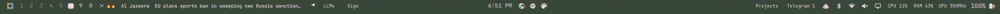
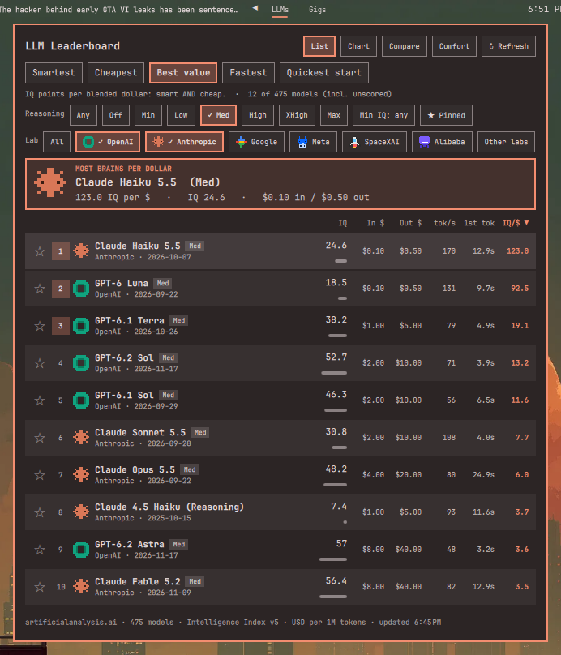
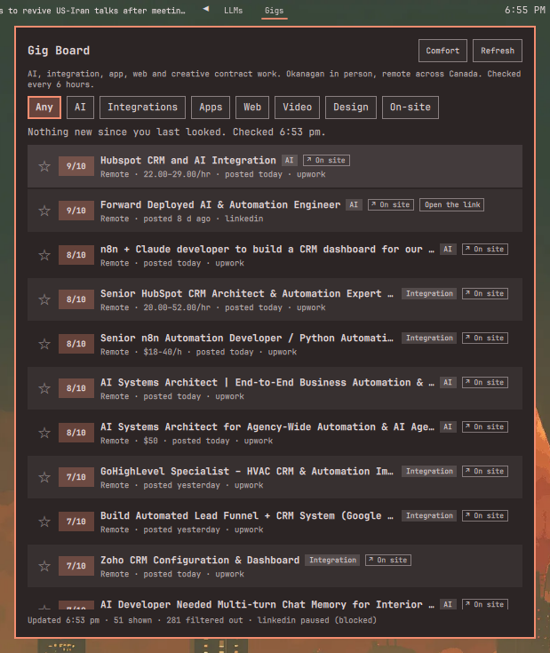
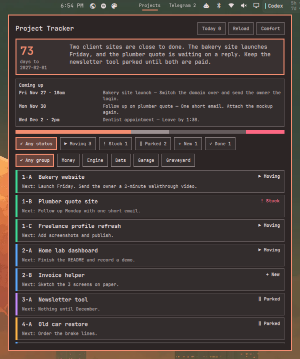
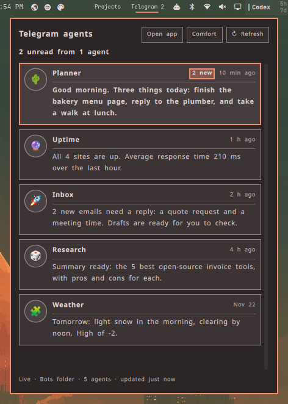
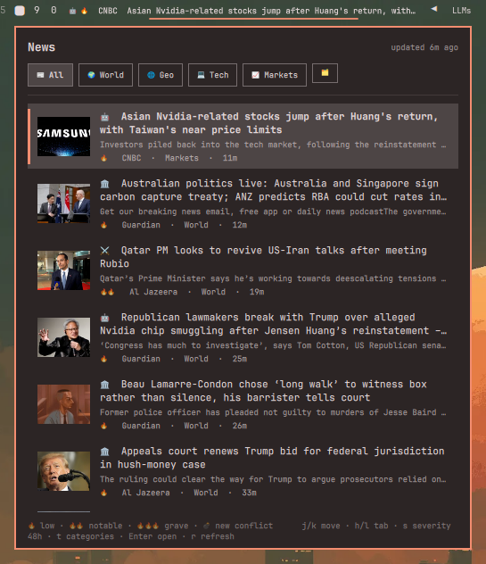
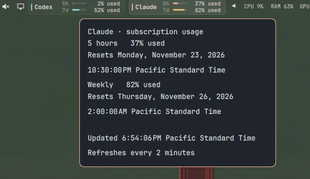
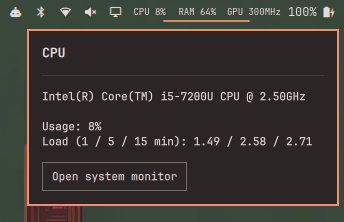
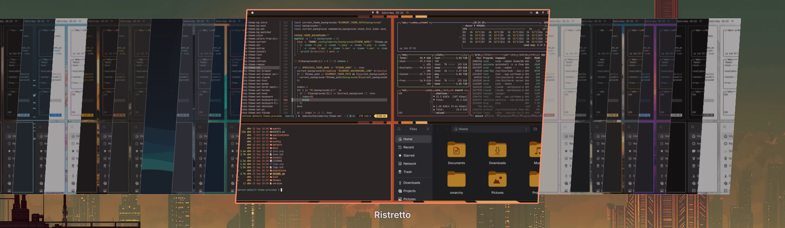

# Omarchy widgets

Nine top-bar widgets and panels for the [Omarchy](https://omarchy.org) Linux desktop (Quickshell / QML),
built by Malik Baptiste ([@MilkBaptiste](https://github.com/MilkBaptiste)).

They share one look: square, sharp, theme-colored (they follow whatever Omarchy theme you switch to),
with tiny 8-bit mascots. Every panel ships a **Comfort** mode built for ADHD and dyslexia:
a readable font (Atkinson Hyperlegible, Lexend or OpenDyslexic), bigger text, row stripes, a simple view,
and fewer things competing for attention.



*The top bar: the news ticker, LLMs and Gigs on the left; Projects, Telegram and CPU/RAM/GPU on the right.*

## The widgets

| Widget | What it does |
|---|---|
| [`milk.llm-rankings`](#llm-leaderboard-milkllm-rankings) | LLM leaderboard: smartest, cheapest, best value, fastest. |
| [`milk.gigs`](#gig-board-milkgigs) | A "jobs section of the newspaper" for contract gigs. |
| [`milk.project-tracker`](#project-tracker-milkproject-tracker) | Your projects by stage and health, with a countdown and what's coming up. |
| [`milk.telegram`](#telegram-agents-milktelegram) | Live cards for your Telegram bot chats. |
| [`milk.news`](#news-milknews) | Headline ticker in the bar, news panel on click. |
| [`milk.ai-usage`](#ai-usage-milkai-usage) | Claude and Codex subscription usage meters. |
| [`milk.system-stats`](#system-stats-milksystem-stats) | CPU, memory and GPU in the bar, with detail panels. |
| [`milk.themes`](#themes-milkthemes) | One-click Omarchy theme switcher. |
| [`milk.bar-fit`](#bar-fit-milkbar-fit) | Keeps bar widgets from overlapping on a crowded bar. |

---

### LLM leaderboard (`milk.llm-rankings`)



Ranks models from Artificial Analysis by **Smartest**, **Cheapest**, **Best value** (IQ points per dollar),
**Fastest** and **Quickest start**. The big card on top is the answer for the view you picked.
Filters are multi-select (reasoning level, minimum IQ, labs), and each lab has its own 8-bit mascot.
Click a column header to sort, click a row to expand it, star a model to pin it.
Also has a **Chart** view and a head-to-head **Compare** view. Needs a free Artificial Analysis API key
(setup walks you through it). Respects the API budget with a local daily cap.

### Gig board (`milk.gigs`)



Contract and freelance gigs from several boards in one list, each rated out of 10 for fit.
Category tabs (AI, Integrations, Apps, Web, Video, Design, On-site), a star to save,
and a **NEW** tag on anything you haven't seen. Each card shows how you'd apply
(email or on the site) before you click. The bar button shows the NEW count.
Reads a local gig-board backend (not included).

### Project tracker (`milk.project-tracker`)



*Screenshot uses demo data.*

The headline card says what matters right now, next to a countdown to your target date.
Below it: what's coming up, a status bar, then every project with its **next step** and its health
(Moving, Stuck, Parked, New, Done). Filter by status and by group (Money, Engine, Bets, Garage, Graveyard).
Your edits, ticks and notes are saved locally and survive data refreshes.

### Telegram agents (`milk.telegram`)



*Screenshot uses demo data.*

One card per bot in a Telegram folder, newest first, with unread counts and pinned chats on top.
Reply in place, hold to dictate a voice reply, play voice notes, or jump to the chat in the Telegram app.
Live connection with a cached last state, so the panel is never empty. Needs your own Telegram API login.

### News (`milk.news`)



A headline ticker in the bar, and a news panel on click with tabs (World, Geo, Tech, Markets).
Each story has a thumbnail, a short summary, the source, its age, and a severity mark.
Keyboard driven: `j`/`k` to move, `h`/`l` to switch tabs, Enter to open. RSS only, no API keys.

### AI usage (`milk.ai-usage`)



Claude and Codex subscription usage as two small meters in the bar (5-hour and weekly windows).
Hover for the exact numbers and when each limit resets. Refreshes every 2 minutes.

### System stats (`milk.system-stats`)



CPU, RAM and GPU readouts in the bar. Click one for a detail panel (Tab switches between them),
with a button that opens the system monitor (btop).

### Themes (`milk.themes`)



One square button in the bar. Left click opens Omarchy's theme switcher (shown above: preview
thumbnails, type to filter, Enter to apply). Right click opens the background switcher for the current theme.

### Bar fit (`milk.bar-fit`)

No panel of its own. It watches the bar, and when it gets too crowded it collapses the long text widgets
(the news ticker and the AI usage meters) so nothing overlaps. Each of those has its own ◂/▸ arrow, visible in the
[top bar screenshot](screenshots/top-bar.png) next to the news ticker.

## Install

Each folder is a self-contained Omarchy shell plugin (the shared `Chip`, `T` and `Mascot` components are
copied into every folder).

```bash
git clone https://github.com/MilkBaptiste/omarchy-widgets
cp -r omarchy-widgets/milk.llm-rankings ~/.config/omarchy/plugins/
omarchy plugin enable milk.llm-rankings
omarchy-restart-shell
```

Some widgets need their own data source. Check the README inside each folder:
`milk.telegram` needs your own Telegram API login, `milk.gigs` reads a local gig-board backend,
`milk.llm-rankings` needs a free Artificial Analysis API key (it walks you through setup).
No keys or personal data are stored in this repo.

## Design rules

- Colors, sizes and corners come from the active Omarchy theme. Nothing is hardcoded.
- Buttons show state with check marks, bold text and borders, never by color alone.
- No auto-scrolling, flashing or moving text in panels. Click a row to expand it inline (no pop-up dialogs).
- Data is cached in `~/.cache/<widget>/`. The last good data stays on screen if a fetch fails.

## License

MIT. See [LICENSE](LICENSE).
